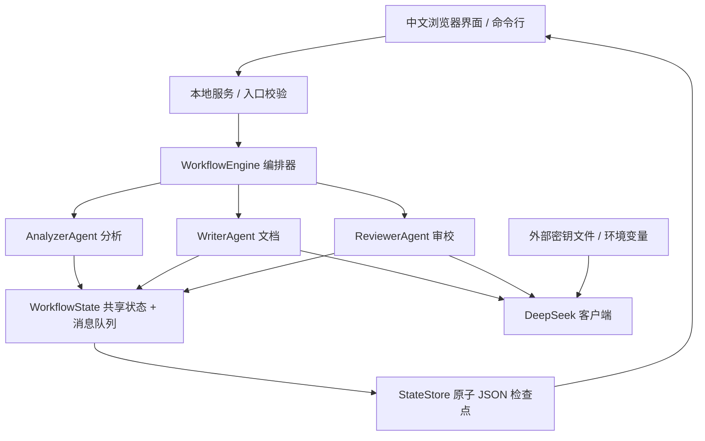
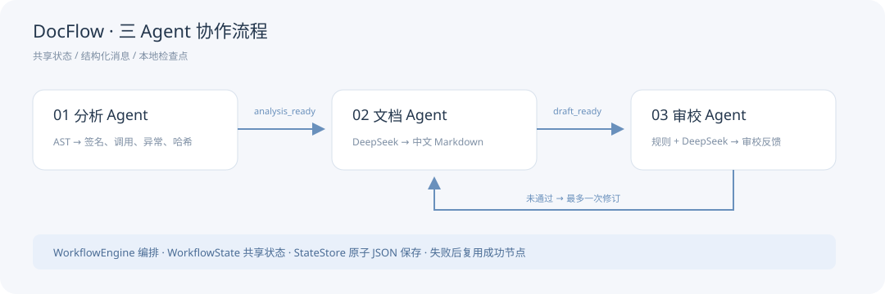
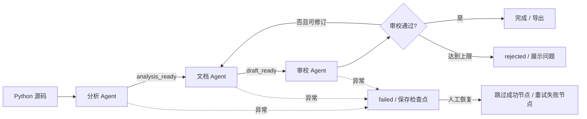

# DocFlow 设计说明

## 1. 目标与边界

构建一个两周范围内可完成的三 Agent 工作流，通过“代码分析 → 文档生成 → 文档审校”展示编排、通信、状态管理与恢复机制。核心交付为可运行源码、项目说明、架构说明和运行证据。输入是单个 Python 文件，输出为中文 Markdown 文档和可审计 JSON 执行记录。

默认使用 DeepSeek：文档 Agent 和审校 Agent 分别独立调用模型；分析 Agent 用 AST 提取事实，减少模型对签名和源码结构的误读。离线模式用规则代替模型，便于无网络演示和稳定测试。

## 2. 架构





服务层只负责输入校验、创建后台线程、提供状态和导出接口；核心工作流不依赖 HTTP。命令行复用相同 Engine 与 Agent。

## 3. 工作流



自动修订上限为一次，即初稿加一次修订，文档 Agent 正常最多执行两轮。修订前将旧审校节点置为 pending，确保重启不会把旧草稿的审校结果复用到新草稿。

## 4. Agent 职责

| Agent | 输入 | 决策/处理 | 输出与消息 |
| --- | --- | --- | --- |
| 分析 | 源码、文件名 | AST 语法解析、遍历定义、提取签名、调用、异常与 SHA-256 | 分析事实，analysis_ready → writer |
| 文档 | 分析事实、上轮审校问题 | 独立文档角色提示词；依照模板生成或修订 | Markdown、模型调用信息，draft_ready → reviewer |
| 审校 | 分析事实、草稿 | 规则核对章节/来源/签名；独立模型角色审查事实一致性 | approved、issues、warnings、覆盖率；通过发给编排器，否则发给 writer |

Agent 不直接控制下一节点。节点返回 `AgentResult(output, messages)`，编排器写入共享状态，再决定继续、修订或结束。当前消息机制为进程内消息加 JSON 记录，不是外部消息中间件。

## 5. 数据结构与通信协议

`WorkflowState` 包括：id、filename、source、mode、status、nodes、outputs、messages、logs、attempts、error、created_at、updated_at。

消息格式示例：

```json
{
  "sender": "analyzer",
  "receiver": "writer",
  "kind": "analysis_ready",
  "payload": {"filename": "order_service.py", "functions": []},
  "timestamp": "2026-10-13T03:00:00.000+00:00"
}
```

示例仅说明协议，不代表真实运行时间。真实消息载荷含 AST 事实、草稿或审校反馈；状态输出按 Agent 名称分区。时间在存储中使用 UTC，界面按用户浏览器本地时区显示。

## 6. 状态机与恢复

工作流状态：pending → running → completed / failed / rejected。节点状态：pending → running → succeeded / failed。

- 每次节点开始和完成、失败、请求修订与流程结束时保存 JSON。
- 写入临时文件后用同目录替换，避免写到一半损坏正常检查点。
- 每个任务只有一个工作线程；管理器拒绝同时恢复同一任务。
- 启动时将残留 running / pending 任务标为 failed，说明上次中断。
- 恢复时跳过 succeeded 节点，重新执行未完成节点。
- 语法错误不会因重试自动消失，必须修正输入后新建任务。
- rejected 表示业务审校不通过，区别于服务异常；到达修订上限后保留问题和草稿。

本版没有自动指数退避、数据库事务或跨进程调度。JSON 原子替换不等同于断电场景下的数据库持久性保证。

## 7. DeepSeek 调用

客户端用 Python 标准库发送 POST 到 `/chat/completions`，密钥放在 Authorization 请求头中。默认 base URL 为 `https://api.deepseek.com`，模型为 `deepseek-flash`。模型选择依据 [官方 API 文档](https://api-docs.deepseek.com/zh-cn/)；通过环境变量可配置。

文档提示词要求只依据静态事实，保留所有二级章节、完整签名与源码哈希；审校提示词要求返回结构化 JSON，并区分严重事实问题和建议。模型返回 JSON 不合规视为失败，可以恢复重试。

单次 HTTP 超时为 90 秒，最大输出为 6000 tokens。正常 AI 流程有两次模型调用；触发一次修订时有四次。日志保存请求 ID、模型名和 usage，以便确认是真实调用，不保存请求密钥或上游错误响应正文。

## 8. 接口

| 方法 | 路径 | 用途 |
| --- | --- | --- |
| GET | `/api/config` | 只返回是否已配置、提供商、模型及默认模式 |
| GET | `/api/sample` | 读取自带样例 |
| POST | `/api/runs` | 创建任务，JSON 字段 filename/source/mode |
| GET | `/api/runs` | 历史任务摘要 |
| GET | `/api/runs/{id}` | 完整运行状态 |
| POST | `/api/runs/{id}/resume` | 恢复失败或中断任务 |
| GET | `/api/runs/{id}/document` | 下载 Markdown 草稿或通过版本 |
| GET | `/api/runs/{id}/trace` | 下载完整执行记录 |

页面每秒读取当前任务状态；任务结束时停止轮询。草稿下载不代表已批准，最终状态与审校标签是判断依据。

## 9. 可扩展性

新增节点实现 `name` 和 `run(state) -> AgentResult`，将实例加入 `WorkflowEngine(agents=[...])`。引擎的主顺序执行支持任意节点列表，默认审校反馈分支识别 writer / reviewer 两个约定角色。

例如在审校后新增摘要 Agent：

```python
class SummaryAgent:
    name = "summary"
    def run(self, state):
        return AgentResult({"summary": "..."})

engine = WorkflowEngine(store, [AnalyzerAgent(), WriterAgent(), ReviewerAgent(), SummaryAgent()])
```

如果需要只在审校通过后运行后置节点，应调整引擎：先完成 writer/reviewer 的反馈分支，再调度后置节点。本版默认三个节点，示例说明接口，**不宣称当前支持任意图结构或后置门控**。更换语言可替换 Analyzer；更换模型服务可替换 llm 客户端。

## 10. 输入与凭据处理

源码最多 256 KB；仅使用 AST，不导入或执行用户代码。HTTP 仅监听 127.0.0.1，校验 Host 和 Origin，拒绝跨站 JSON 写入。页面用 textContent 展示不可信源码与模型文本，不把其作为 HTML 执行。任务 ID 只允许 32 位十六进制，文件名不用于服务器读取路径。

密钥在项目外部读取。提示词把 docstring 和文件名等作为数据，不赋予指令权限。语义审校是模型建议，不能完全消除提示注入或事实错误；正式使用仍需要人工复核。

## 11. 技术取舍

只用标准库降低部署门槛；本地网页提供运行可视化；确定性 AST 与规则保障结构正确，模型负责语言与补充语义审校；JSON 便于课程展示和调试。未实现单个工作流的并行节点、多租户、项目目录批量分析或可拖拽编排。
